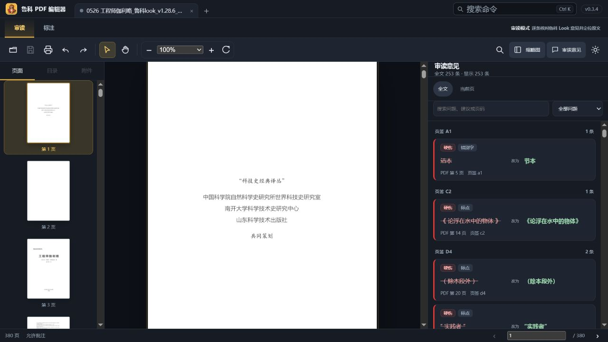
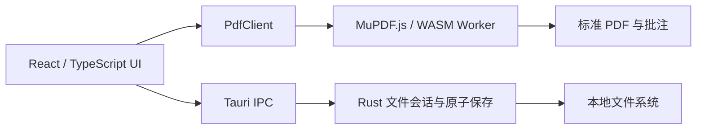

# 鲁科 PDF 编辑器

[](https://github.com/CommonerOfWestWall/luke-pdf-editor/actions/workflows/ci.yml)
[](https://github.com/CommonerOfWestWall/luke-pdf-editor/releases)
[](LICENSE)
[](#下载与安装)

简体中文 | [English](README.en.md)

鲁科 PDF 编辑器是一款面向审读、批注和长文档工作的本地 PDF 桌面应用。项目首先服务于 **鲁科 Look 审读产物**：逐条查看结构化审读意见，在 PDF 原文和修改建议之间快速定位；同时逐步扩展为通用、现代、开源的 PDF 工作站。

- 完全离线，核心工作流不需要账户和云服务。
- 使用标准 PDF 批注，不把正式数据锁在私有格式中。
- 支持多文档标签、长文档虚拟渲染、全文搜索、真实缩略图和常用文字标记。
- Windows 安装版可注册为 PDF 打开候选，并为资源管理器提供真实首页缩略图。
- 明确记录已实现、部分实现和计划功能，不以“能打开 PDF”冒充完整编辑器。

> **项目状态：公开预览版。** v0.3.5 已通过当前自动化与桌面回归门禁，但仍缺少 OCR、表单创建、页面组织、内容对象编辑、崩溃恢复、完整无障碍和跨阅读器全量兼容验证。它还不能完整替代 PDF-XChange Editor。



## 下载与安装

前往 [GitHub Releases](https://github.com/CommonerOfWestWall/luke-pdf-editor/releases) 下载最新的 `鲁科 PDF 编辑器_*_x64-setup.exe`。

当前安装包：

- 适用于 Windows 10/11 x64；
- 使用简体中文、当前用户范围安装；
- 包含 PDF 静态图标和资源管理器首页缩略图处理器；
- 尚未进行 Authenticode 代码签名，Windows 可能显示“未知发布者”；
- 不绕过 Windows 安全策略强制修改默认应用，安装后需由用户在系统设置中确认。

v0.3.5 的构建、哈希和安装验证见[安装包验证记录](docs/validation/0.3.5-windows-installer.md)。

## 当前能力

| 领域 | 当前状态 |
|---|---|
| 鲁科 Look 审读 | 解析结构化意见，展示问题片段、修改建议、依据和提示；支持列表与详情连续复核 |
| 查看与导航 | 多文档标签、连续页、缩放、旋转、页码跳转、全文搜索、文字选择、链接、真实缩略图 |
| 批注 | 读取标准批注；便签、自由文本、高亮、下划线、删除线、波浪线；撤销与重做 |
| 评论工作流 | 全文/当前页筛选、问题分类、搜索、页码定位、窗口化长列表、右栏编辑 |
| 打印 | 打印预览、页范围、批注开关、页外批注条和半透明连接线；仍待多打印机实测 |
| Windows 集成 | PDF 打开候选、命令行/双击启动、静态文件图标、Explorer 首页缩略图 |
| 安全保存 | 受限文件会话、原子替换、外部修改冲突检测；仍待磁盘写满和网络路径加固 |

逐项证据和未完成边界以[功能矩阵](docs/feature-matrix.md)为准。

## 常用操作

| 操作 | 快捷键 |
|---|---|
| 打开 PDF | `Ctrl+O` |
| 保存 | `Ctrl+S` |
| 打印 | `Ctrl+P` |
| 搜索命令 | `Ctrl+K` |
| 查找 | `Ctrl+F` |
| 撤销 / 重做 | `Ctrl+Z` / `Ctrl+Y` |
| 高亮 / 下划线 / 删除线 / 波浪线 | `H` / `U` / `S` / `W` |
| 便签 / 文本框 | `N` / `T` |
| 临时抓手 | 按住 `Space` |
| 退出当前工具 | `Esc` |
| 意见列表移动 | `↑` / `↓`，`Enter` 打开详情 |

文字标记既支持先按快捷键再选择文字，也支持先选择文字再按快捷键。创建标记后不会弹出阻断式窗口，批注内容可在右侧栏立即填写或稍后补充。

## 为什么开源

专业 PDF 工作流不应该迫使用户把文档上传到云端，也不应该用私有批注格式锁定审读数据。本项目采用 AGPL 路线复用 MuPDF，并公开产品边界、测试证据和兼容性缺口。欢迎贡献代码、测试样本描述、交互建议和跨阅读器验证结果。

本项目借鉴开源阅读器的工程思路，但不复制 PDF-XChange 的代码、图标、商标、文案或像素级界面。外部参考与许可证判断记录在[开源参考登记](docs/open-source-reference-register.md)。

## 从源码运行

### 环境

- Windows 10/11 x64 与 WebView2 Runtime
- Node.js 24+
- npm 11+
- Rust 1.95+

### 开发模式

```powershell
git clone https://github.com/CommonerOfWestWall/luke-pdf-editor.git
cd luke-pdf-editor
npm install
npm run tauri dev
```

只运行前端：

```powershell
npm run dev
```

浏览器模式通过文件选择器打开 PDF，保存时下载新文件；桌面模式通过 Rust 受限文件会话执行原子保存。

### 质量检查

```powershell
npm test
npm run build
cargo fmt --manifest-path src-tauri/Cargo.toml -- --check
cargo clippy --manifest-path src-tauri/Cargo.toml --all-targets -- -D warnings
cargo test --manifest-path src-tauri/Cargo.toml
```

完整门禁、桌面 E2E 和测试语料要求见[质量门禁](docs/quality-gates.md)与[贡献指南](CONTRIBUTING.md)。

### 构建 Windows 安装包

```powershell
npm run bundle:windows
```

该命令构建缩略图处理器、生成第三方许可证清单并创建 NSIS 安装包。输出位于 `src-tauri/target/release/bundle/nsis/`。

## 架构



- `src/app/`：应用外壳、命令、工作区状态和批注界面。
- `src/pdf/`：Worker、渲染调度、坐标转换、批注读写和文本标记几何。
- `src-tauri/src/`：安全文件会话、Windows 启动参数、原子保存和系统集成。
- `src-tauri/thumbnail-handler/`：独立 Windows `IThumbnailProvider`。
- `docs/`：ADR、功能矩阵、路线图、研究和验证证据。

核心边界详见[架构决策记录](docs/adr/)。

## 参与项目

- 功能建议和普通缺陷使用 [Issues](https://github.com/CommonerOfWestWall/luke-pdf-editor/issues)。
- 使用问题和方案讨论使用 [Discussions](https://github.com/CommonerOfWestWall/luke-pdf-editor/discussions)。
- 安全漏洞请使用 GitHub 的私密漏洞报告，不要公开上传恶意或敏感 PDF。
- 提交代码前请阅读[贡献指南](CONTRIBUTING.md)、[行为准则](CODE_OF_CONDUCT.md)和[支持说明](SUPPORT.md)。

下一阶段计划见[公开路线图](docs/roadmap.md)。路线图不是交付承诺，实际优先级由可复现问题、鲁科 Look 工作流和兼容性证据决定。

## 许可证

鲁科 PDF 编辑器使用 [GNU AGPL-3.0-or-later](LICENSE)。网络交互或分发修改版本时，必须依照 AGPL 提供对应源代码。

MuPDF.js 同时提供 AGPL 和商业许可；本项目选择 AGPL 路线。第三方组件和归属信息见[第三方声明](THIRD_PARTY_NOTICES.md)与[完整依赖许可证清单](docs/legal/THIRD_PARTY_LICENSES.md)。
