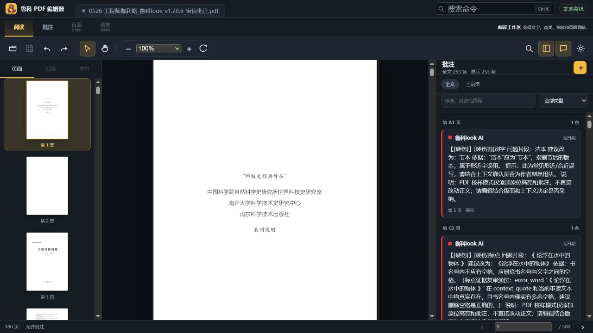
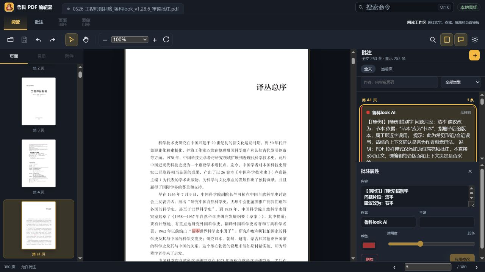
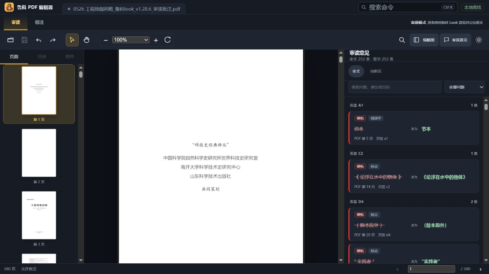
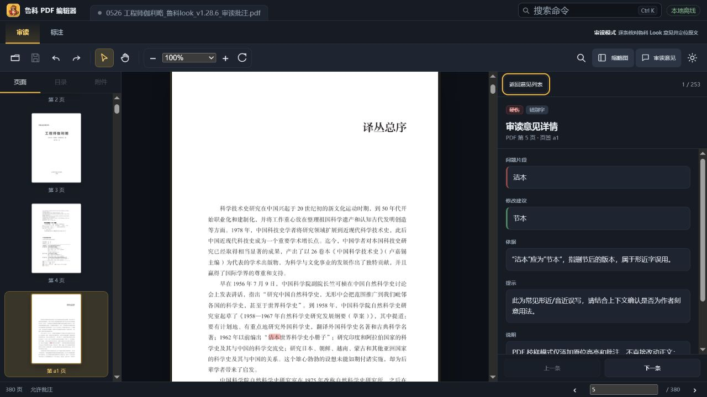
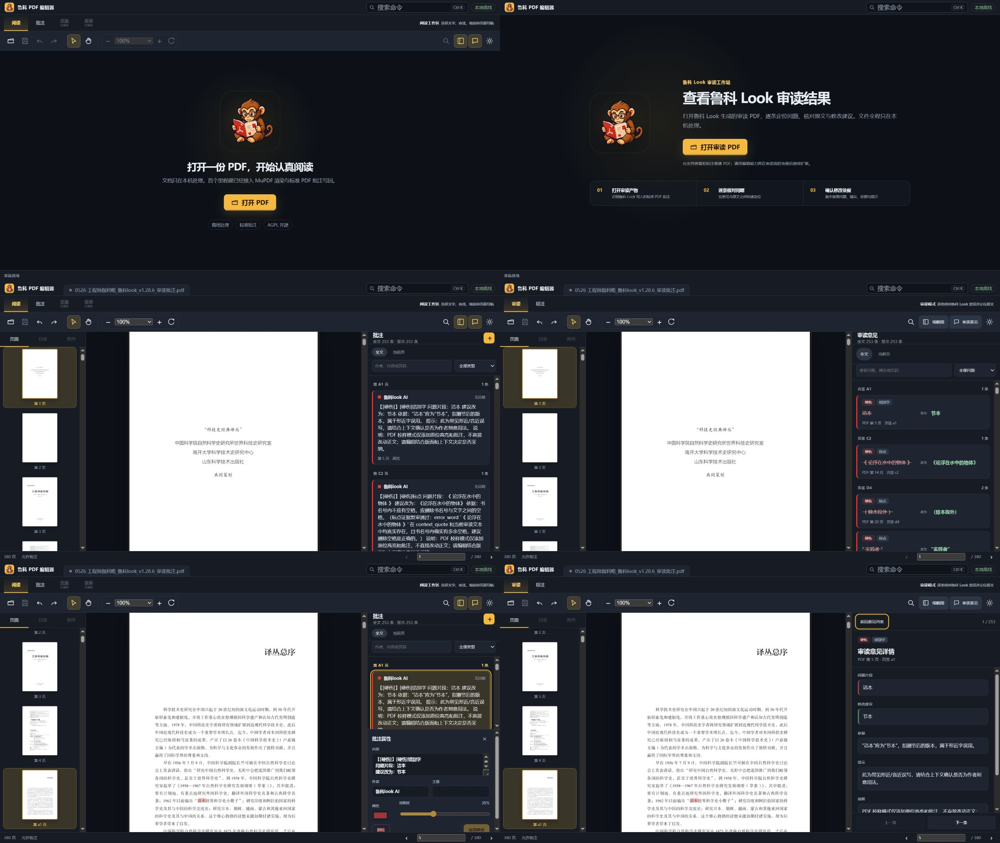

# 鲁科 Look 审读工作流 UI 审计

日期：2026-07-24 
范围：首页 → 打开鲁科 Look 审读 PDF → 浏览意见 → 打开单条批注详情。 
目标：让编辑人员能快速识别问题、定位原文、理解建议，并在长文档的数百条意见间连续复核。

## Step 1：首页

健康度：需要重做信息层级。

- 优点：主操作“打开 PDF”明显；离线状态可见；图标与深色主题形成了已有品牌识别。
- 主要问题：
  - 标题“打开一份 PDF，开始认真阅读”没有说明这是鲁科 Look 审读产物查看器。
  - 副文案暴露 MuPDF 和里程碑等研发信息，不能帮助编辑人员判断产品价值。
  - 空文档时仍展示模式栏、工具栏和大量禁用按钮，形成三个水平层级，主任务被稀释。
  - “AGPL 开源”是产品属性，不是打开审读产物前最重要的用户收益。
- 可见无障碍风险：顶部禁用控件对低视力用户仍有较强视觉存在；首页缺少对支持文件和后续流程的明确说明。

## Step 2：审读工作区

健康度：基础可用，但不适合高密度审读。

- 优点：缩略图、正文和意见栏三栏关系清楚；点击意见能定位页面；253 条意见可以一次读取。
- 主要问题：
  - “阅读”模式处于选中状态，但右侧已经打开“批注”面板，模式命名和实际任务冲突。
  - 页面、表单等不可用模块占据一级导航，早期产品主线不清晰。
  - 右侧卡片原样展示整段机器批注，单张卡片过高，720px 高度只能看到约两条意见。
  - 鲁科 Look 已经提供“问题片段、建议改为、依据、提示”等结构，界面却没有利用。
  - 页签标签（如 A1）与 PDF 索引页码（如第 5 页）分别出现在组标题和卡片底部，没有解释两套页码。
  - 右上角导航/意见按钮只有图标，选中态边框和黄色填充过重，尺寸及含义不够稳定。
- 可见无障碍风险：卡片正文密度高、次要文字过小；多个仅图标按钮依赖 tooltip 才能理解。

## Step 3：单条批注详情

健康度：操作区拥挤，核心信息被“属性表单”淹没。

- 优点：选中态明确；页面已同步定位；编辑、删除能力有权限门控。
- 主要问题：
  - 属性编辑器从底部挤入，列表和详情同时存在于 340px 窄栏，二者都不够用。
  - 用户首先需要核对“原文片段 → 修改建议 → 依据”，界面首先呈现的是原始长文本、作者、主题、颜色和透明度。
  - 应用修改按钮贴近窗口底部，且需要在小滚动区内寻找。
  - 缺少上一条/下一条意见，连续复核需要回到列表反复点击。
- 可见无障碍风险：9–11px 表单标签和正文偏小；详情出现属于明显状态变化，但缺少标题层级和“返回列表”的明确入口。截图不足以确认完整键盘和屏幕阅读器行为。

## 本轮改造决策

1. 前期产品目标改为“鲁科 Look 审读产物查看与复核”，通用 PDF 编辑能力保留但不再主导首页和一级导航。
2. 空文档时隐藏工作区模式栏和命令栏，只保留品牌、打开入口、支持说明和离线承诺。
3. 一级模式改为“审读 / 标注”；隐藏尚未实现的页面和表单入口。
4. 右侧改为“意见列表 / 单条详情”两级视图，不再把属性编辑器挤在列表底部。
5. 解析鲁科 Look 批注结构，列表优先展示问题类型、问题片段、修改建议；详情展示依据和提示。
6. 面板按钮使用图标加文字、统一 32px 高度；审读栏扩大到适合中文长文本的宽度。

## 证据边界

- 本审计基于当前浏览器开发版和用户提供的 380 页、253 条意见样本。
- 截图可以确认视觉层级、密度和可见交互，不足以证明完整 WCAG 合规、触屏目标尺寸或屏幕阅读器朗读顺序。

## 改造后对照

- 首页已经移除空文档时的两层工具栏和技术里程碑宣传，首屏只解释鲁科 Look 审读价值、离线承诺和三步流程。
- 一级模式现在与任务一致：审读模式负责复核，标注模式负责创建；未实现的页面/表单入口不再占据主导航。
- 右侧栏从 340px 扩展到 380px，缩略图和审读意见开关使用图标加文字、至少 32px 高的弱选中按钮。
- 原始长批注被压缩为“问题片段 → 修改建议”卡片；720px 高度下可以同时看到更多意见。
- 详情视图独占侧栏，优先呈现问题、建议、依据、提示和说明，并提供上一条/下一条；原始属性编辑默认收起。

改造后截图使用与改造前相同的 1280×720 浏览器视口。组合图左列为改造前，右列为改造后。
